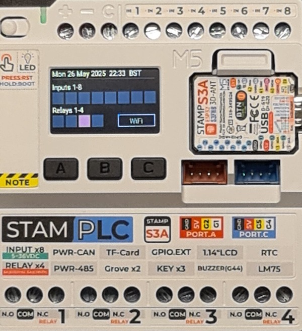
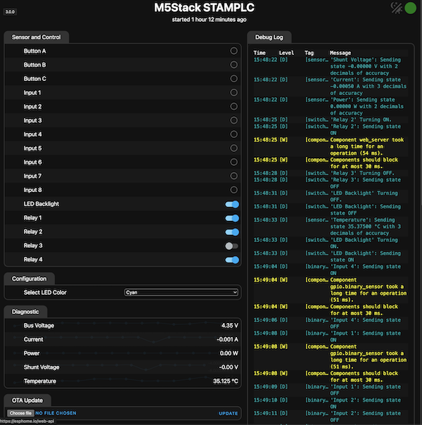
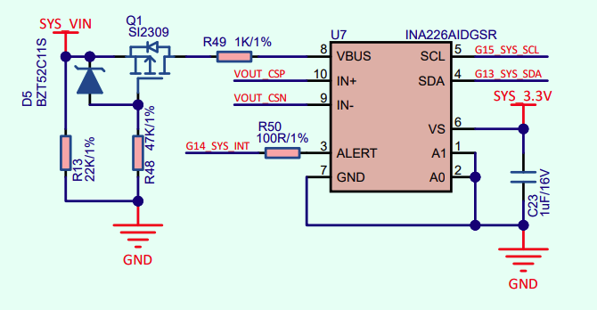
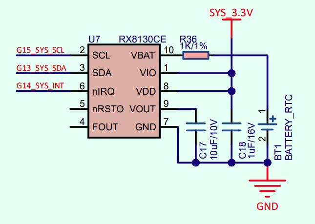

# esphome-m5stamplc
# ESPHome configuration &amp; components for the M5StamPLC controller.

If you find this useful please consider supporting me by buying me a coffee. Thank you!

[](https://www.buymeacoffee.com/jvn5gy8fdy)

https://docs.m5stack.com/en/core/StamPLC

  

  

The example config requires wifi to be configured. Don't forget to set the timezone for your location under the time section of the config. The LCD screen displays relay and input status along with date/time and wifi connection status. If the Home Assistant API is enabled then all the relays, inputs, buttons and diagnostic controls show up in the Home Assistant UI.

## Arduino Vs. ESP-IDF Compilation

Using the Arduino framework will result in faster compilation time but larger RAM and Flash size. Using the ESP-IDF framework will result in slower compilation time but more efficient use of RAM and smaler Flash size. [Configuration.yaml](configuration.yaml) uses esp-idf.

Arduino:

```yaml
esp32:
  flash_size: 8MB
  variant: ESP32S3
  framework:
    type: arduino
```

ESP-IDF:

```yaml
esp32:
  flash_size: 8MB
  variant: ESP32S3
  framework:
    type: esp-idf
```

## Home Assistant UI / Local Web Inteface (http://m5stamplc.local)

**Components**  
AW9523 (GPIO Expander 2)  
LM75B (Temperature Sensor)  
RX8130 (RTC)

**Controls**:  
LCD Backlight    
Relays 1-4

**Sensors**:  
Buttons A,B,C  
Inputs 1-8

**Configuration**:  
LED Indicator*

**Diagnostics**:  
Bus Voltage  
Shunt Voltage**  
Current**  
Power  
Temperature


*The LED indicator light is 3-bit only and can show a maximum of 8 colours using the selection control. On startup the LED indicator is red (wifi not connected). Once connected to wifi the LED indicator turns blue.

**Note that the INA226 voltage/current/power sensor on the StamPLC is only connected to the SYS_VIN bus. Therefore it only measures the current and voltage of the GPIO.EXT expansion inteface (to the side of the unit) and not the relays or grove intefaces.

  

The M5StamPLC has an internal RTC chip (RX8130) which is connected to a rechargeable battery. The RX8130 component included in this project enables battery charging and automatic battery power switching should the M5StamPLC lose power. Since the configuration is using Wifi and SNTP, the internal RTC chip is initially set from SNTP. On subsequent restarts, the RTC chip's time is used to set the system clock until/unless SNTP becomes available.

 

In time, these components will be submitted to ESPHome to be included as standard components.

Please post your example configs in the discussion area - especially any LVGL/Display configurations.

TODO: One single M5StamPLC component to abstract away some of the configuration complexities and to bring all the dependencies together. Modbus RS485 support is also planned.

NB: The controller uses GPIO03 strapping pin as RESET. It needs to be pulled HIGH during boot for the GPIO Expander to initialise correctly:

This can be achieved for both arduino and esp-idf frameworks using the power_supply component. Ensure the power_supply component comes before the pi4ioe5v6408 and aw9523 components:

```yaml
# <--- Keep this section in this order --->

# Set pin 3 high on boot for aw9523 and
# pi4ioe5v6408 to initialise correctly. 
power_supply:
  id: pin3_output_high
  pin: 
    number: 3
    ignore_strapping_warning: true
  enable_on_boot: true
# Configuration of i2c GPIO Expander 1 
pi4ioe5v6408:
  - id: pi4ioe5v6408_1
    address: 0x43
# Configuration of i2c GPIO Expander 2
aw9523:
  - id: aw9523_1
    address: 0x59

# <--- End of ordered section --->
```

## Example Configuration YAML:

```yaml
esphome:
  name: m5stamplc
  friendly_name: 'M5Stack STAMPLC'
  min_version: 2025.7.0
  on_boot:
    - then:
        rx8130.read_time:

# Import external components...
external_components:
  - source: github://beormund/esphome-m5stamplc@main
    components: [aw9523, lm75b, rx8130]

esp32:
  flash_size: 8MB
  variant: ESP32S3
  framework:
    type: esp-idf

# Disable safe mode for OTA
safe_mode:
  disabled: true

# Allow Over-The-Air updates
ota:
  - platform: esphome
  - platform: web_server

#Enable logging
logger:

# Enable Home Assistant API
api:

wifi:
  id: wifi_1
  ssid: !secret wifi_ssid
  password: !secret wifi_password
  on_connect:
    then:
      - component.update: vdu
      - select.set:
          id: select_led_color
          option: "Green"
  on_disconnect:
    then:
      - component.update: vdu
      - select.set:
          id: select_led_color
          option: "Red"      

# To have a HA style local web page for device monitoring
web_server:
  port: 80
  version: 3
  log: true
  local: true

# Time
time:
  - platform: rx8130
    id: rx8130_time
    update_interval: 30 min
    on_time_sync:
      then:
        - component.update: vdu
  - platform: sntp
    id: sntp_time
    timezone: Europe/London
    on_time_sync:
      then:
        - rx8130.write_time:
            id: rx8130_time
        - component.update: vdu
    on_time:
      - cron: '0 * * * * *'
        then:
          - component.update: vdu

i2c:
  sda: GPIO13
  scl: GPIO15
  scan: false

spi:
  clk_pin: GPIO7
  mosi_pin: GPIO8
  miso_pin: GPIO9

# RS485 pin config
uart:
  tx_pin:
    number: GPIO0
    ignore_strapping_warning: true
  rx_pin: GPIO39
  baud_rate: 9600
  parity: EVEN

globals:
  - id: double_beep
    type: std::string
    max_restore_data_length: 34
    initial_value: '"two_short:d=4,o=5,b=100:16e6,16e6"'

# <--- Keep this section in this order --->

# Set pin 3 high on boot for aw9523 and
# pi4ioe5v6408 to initialise correctly. 
power_supply:
  id: pin3_output_high
  pin: 
    number: 3
    ignore_strapping_warning: true
  enable_on_boot: true
# Configuration of i2c GPIO Expander 1 
pi4ioe5v6408:
  - id: pi4ioe5v6408_1
    address: 0x43
# Configuration of i2c GPIO Expander 2
aw9523:
  - id: aw9523_1
    address: 0x59

# <--- End of ordered section --->

switch:
  # Relays 1-4
  - platform: gpio
    restore_mode: RESTORE_DEFAULT_OFF
    name: "Relay 1"
    id: r1
    pin:
      aw9523: aw9523_1
      number: 0
      mode:
        output: true
    on_state:
      - component.update: vdu
  - platform: gpio
    restore_mode: RESTORE_DEFAULT_OFF
    name: "Relay 2"
    id: r2
    pin:
      aw9523: aw9523_1
      number: 1
      mode:
        output: true
    on_state:
      - component.update: vdu
  - platform: gpio
    restore_mode: RESTORE_DEFAULT_OFF
    name: "Relay 3"
    id: r3
    pin:
      aw9523: aw9523_1
      number: 2
      mode:
        output: true
    on_state:
      - component.update: vdu
  - platform: gpio
    restore_mode: RESTORE_DEFAULT_OFF
    name: "Relay 4"
    id: r4
    pin:
      aw9523: aw9523_1
      number: 3
      mode:
        output: true
    on_state:
      - component.update: vdu
  # LCD backlight (on/off only)
  - platform: gpio
    restore_mode: ALWAYS_ON
    name: "LCD Backlight"
    pin:
      pi4ioe5v6408: pi4ioe5v6408_1
      number: 7
      inverted: true
      mode:
        output: true
  # led indicator 3-bit (8 colors only)
  - platform: gpio
    restore_mode: ALWAYS_ON
    id: "led_red"
    pin:
      pi4ioe5v6408: pi4ioe5v6408_1
      number: 6
      inverted: true
      mode:
        output: true
  - platform: gpio
    restore_mode: ALWAYS_OFF
    id: "led_green"
    pin:
      pi4ioe5v6408: pi4ioe5v6408_1
      number: 5
      inverted: true
      mode:
        output: true
  - platform: gpio
    restore_mode: ALWAYS_OFF  
    id: "led_blue"
    pin:
      pi4ioe5v6408: pi4ioe5v6408_1
      number: 4
      inverted: true
      mode:
        output: true

# Enable Web/HA UI to set 3-bit colors for LED Status
select:
  - platform: template
    id: select_led_color
    name: "Select LED Color"
    entity_category: config
    initial_option: Red
    optimistic: true
    options:
      - Black
      - Red
      - Green
      - Yellow
      - Blue
      - Magenta
      - Cyan
      - White
    on_value: 
      then:
        - switch.control:
            id: led_red
            state: !lambda return (i & 1);
        - switch.control:
            id: led_green
            state: !lambda return (i & 2);
        - switch.control:
            id: led_blue
            state: !lambda return (i & 4);

output:
  # Set up the pwm buzzer on pin 44
  - platform: ledc
    pin: GPIO44
    id: buzzer

rtttl:
  output: buzzer
  id: buzzer_1

# Inputs 1-8
binary_sensor:
  - platform: gpio
    id: i1
    name: "Input 1"
    pin:
      aw9523: aw9523_1
      number: 4
      mode:
        input: true
    on_state:
      then:
        - component.update: vdu
  - platform: gpio
    id: i2
    name: "Input 2"
    pin:
      aw9523: aw9523_1
      number: 5
      mode:
        input: true
    on_state:
      then:
        - component.update: vdu
  - platform: gpio
    id: i3
    name: "Input 3"
    pin:
      aw9523: aw9523_1
      number: 6
      mode:
        input: true
    on_state:
      then:
        - component.update: vdu
  - platform: gpio
    id: i4
    name: "Input 4"
    pin:
      aw9523: aw9523_1
      number: 7
      mode:
        input: true
    on_state:
      then:
        - component.update: vdu
  - platform: gpio
    id: i5
    name: "Input 5"
    pin:
      aw9523: aw9523_1
      number: 12
      mode:
        input: true
    on_state:
      then:
        - component.update: vdu
  - platform: gpio
    id: i6
    name: "Input 6"
    pin:
      aw9523: aw9523_1
      number: 13
      mode:
        input: true
    on_state:
      then:
        - component.update: vdu
  - platform: gpio
    id: i7
    name: "Input 7"
    pin:
      aw9523: aw9523_1
      number: 14
      mode:
        input: true
    on_state:
      then:
        - component.update: vdu
  - platform: gpio
    id: i8
    name: "Input 8"
    pin:
      aw9523: aw9523_1
      number: 15
      mode:
        input: true
    on_state:
      then:
        - component.update: vdu
  # Buttons 1-3
  - platform: gpio
    name: "Button A"
    pin:
      pi4ioe5v6408: pi4ioe5v6408_1
      number: 2
      inverted: true
      mode:
        input: true
        pullup: true
    on_press:
      - rtttl.play: !lambda return id(double_beep);
  - platform: gpio
    name: "Button B"
    pin:
      pi4ioe5v6408: pi4ioe5v6408_1
      number: 1
      inverted: true
      mode:
        input: true
        pullup: true
    on_press:
      - rtttl.play: !lambda return id(double_beep);
  - platform: gpio
    name: "Button C"
    pin:    
      pi4ioe5v6408: pi4ioe5v6408_1
      number: 0
      inverted: true
      mode:
        input: true
        pullup: true
    on_press:
      - rtttl.play: !lambda return id(double_beep);

sensor:
  # INA226 Voltage/Current Sensor on i2c default Address 0x40
  - platform: ina226
    shunt_resistance: 0.01
    max_current: 8.192
    current:
      name: "Current"
      entity_category: "diagnostic"
    power:
      name: "Power"
      entity_category: "diagnostic"
    bus_voltage:
      name: "Bus Voltage"
      entity_category: "diagnostic"
    shunt_voltage:
      name: "Shunt Voltage"
      entity_category: "diagnostic"
  # LM75B Temp Sensor on i2c default address 0x48 
  - platform: lm75b
    name: "Temperature"
    update_interval: 60s
    entity_category: "diagnostic"

# Some colors for the LED display
color:
  - id: orange
    hex: fff099
  - id: grey
    hex: 3A3B3C
  - id: blue
    hex: 9fcff9
  - id: green
    hex: 51af73
  - id: red
    hex: db6676
  - id: purple
    hex: af69e3

display:
  platform: mipi_spi
  id: vdu
  model: ST7789V
  transform: 
    swap_xy: True
    mirror_x: True
    mirror_y: False
  dimensions:
    width: 240
    height: 135
    offset_width: 40
    offset_height: 52
  spi_mode: 3
  dc_pin: GPIO06
  cs_pin: GPIO12
  invert_colors: true
  update_interval: never
  lambda: |-
    if (id(rx8130_time).now().is_valid()) {
      it.strftime(5, 0, id(font1), Color(orange), "%a %d %b %Y  %H:%M  %Z", id(rx8130_time).now()); 
    }
    if (id(wifi_1).is_connected()) {
      it.print(210, 0, id(wifi_icons), id(green), "\uef10");
    } else {
      it.print(210, 0, id(wifi_icons), id(red), "\uef13");
    }
    it.line(5, 19, 230, 19, id(grey));
    it.print(5, 28, id(font1), id(orange), "Inputs 1-8");
    it.filled_rectangle(5, 47, 25, 25, id(i1).state ? id(purple) : id(grey));
    it.filled_rectangle(34, 47, 25, 25, id(i2).state ? id(purple) : id(grey));
    it.filled_rectangle(63, 47, 25, 25, id(i3).state ? id(purple) : id(grey));
    it.filled_rectangle(92, 47, 25, 25, id(i4).state ? id(purple) : id(grey));
    it.filled_rectangle(121, 47, 25, 25, id(i5).state ? id(purple) : id(grey));
    it.filled_rectangle(150, 47, 25, 25, id(i6).state ? id(purple) : id(grey));
    it.filled_rectangle(179, 47, 25, 25, id(i7).state ? id(purple) : id(grey));
    it.filled_rectangle(208, 47, 25, 25, id(i8).state ? id(purple) : id(grey));
    it.print(5, 80, id(font1), Color(orange), "Relays 1-4");
    it.filled_rectangle(5, 99, 25, 25, id(r1).state ? id(red) : id(grey));
    it.filled_rectangle(34, 99, 25, 25, id(r2).state ? id(red) : id(grey));
    it.filled_rectangle(63, 99, 25, 25, id(r3).state ? id(red) : id(grey));
    it.filled_rectangle(92, 99, 25, 25, id(r4).state ? id(red) : id(grey));

font:
  - file: "gfonts://Roboto"
    id: font1
    size: 15
  - file: "gfonts://Material+Symbols+Outlined"
    id: wifi_icons
    size: 18
    glyphs: [
      "\uef10", # wifi
      "\uef13", # no wifi
    ] 
```
